# Домашнее задание к занятию «Использование Terraform в команде» - Розаев А.Ю.

### Цели задания

1. Научиться использовать remote state с блокировками.
2. Освоить приёмы командной работы.

### Чек-лист готовности к домашнему заданию

1. Зарегистрирован аккаунт в Yandex Cloud. Использован промокод на грант.
2. Установлен инструмент Yandex CLI.
3. Любые ВМ, использованные при выполнении задания, должны быть прерываемыми, для экономии средств.

------

### Задание 0

1. Прочитана статья: https://neprivet.com/
2. Распространение в процессе.

---

### Задание 1

1. Проверен код:
- из [ДЗ к лекции 4](https://github.com/netology-code/ter-homeworks/tree/main/04/src),
- из [демо к лекции 4](https://github.com/netology-code/ter-homeworks/tree/main/04/demonstration1).
2. Проверка кода выполнена с помощью tflint и checkov.
3. В проекте (без дублей), обнаружены следующие **типы** ошибок:


1. По отчету Checkov (Безопасность и цепочка поставок):

• Использование изменяемых источников модулей без фиксации коммита (CKV_TF_1): Ссылка на динамическую ветку Git (?ref=main) вместо конкретного хэша коммита (SHA-1).
• Отсутствие релизного тега версии для удаленных модулей (CKV_TF_2): Импорт модулей напрямую из ветки репозитория без указания фиксированного семантического тега версии (например, ?ref=v1.0.0).

2. По отчету TFLint (Синтаксис и качество HCL-кода):

• Отсутствие ограничений версий для провайдеров (terraform_required_providers): Провайдеры yandex, random и template объявлены в коде без указания конкретных версий в блоке required_providers.
• Неиспользуемые переменные (terraform_unused_declarations): Переменные vms_ssh_root_key, vm_web_name, vm_db_name и public_key задекларированы в конфигурации, но нигде не вызываются.

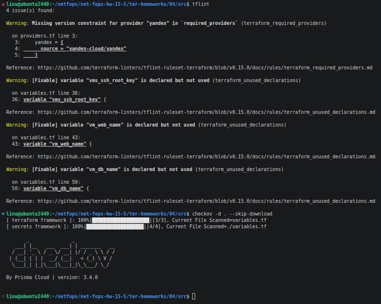

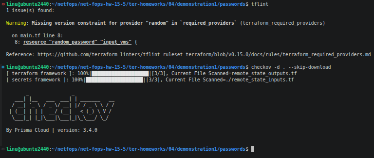

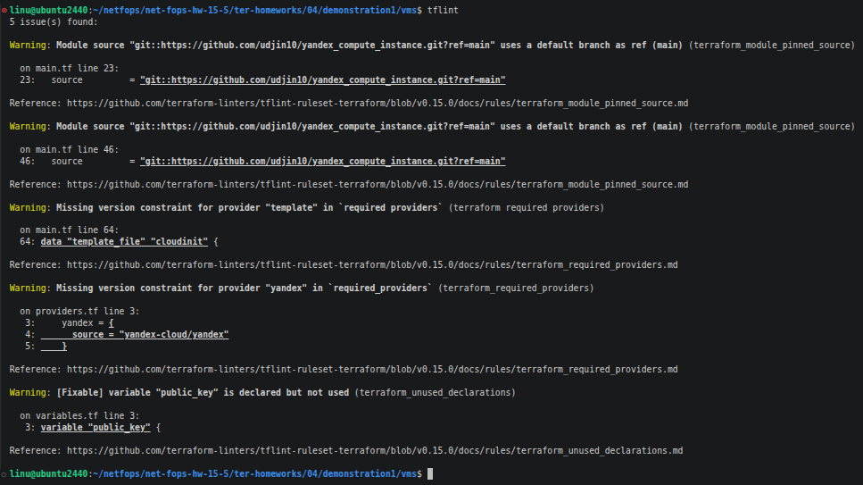

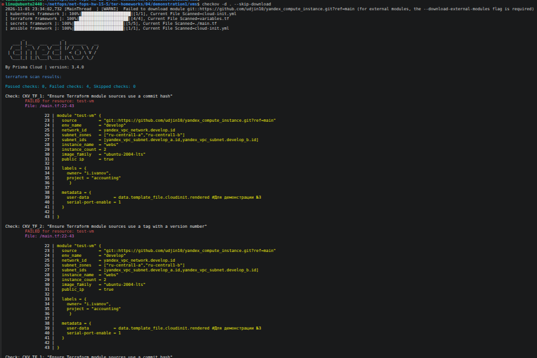

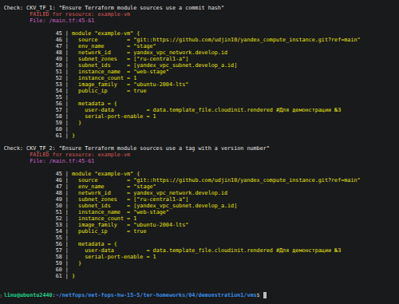

---

### Задание 2

1. Из GitHub-репозитория с **выполненным ДЗ 4** в ветке 'terraform-04' сделана ветка 'terraform-05'.

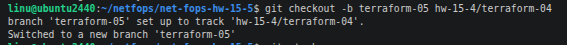

2. Настроен remote state с встроенными блокировками:
   - Создан S3 bucket в Yandex Cloud для хранения state
   - Создан service account назначены права на чтение/запись в bucket
   - Настроен backend в providers.tf с использованием нового механизма блокировок:
     ```hcl
     terraform {
       required_version = "~>1.12.0"
       
       backend "s3" {
         bucket  = "ваш-bucket-name"
         key     = "terraform.tfstate"
         region  = "ru-central1"
         
         # Встроенный механизм блокировок (Terraform >= 1.6)
         # Не требует отдельной базы данных!
         use_lockfile = true
         
         endpoints = {
           s3 = "https://storage.yandexcloud.net"
         }
         
         skip_region_validation      = true
         skip_credentials_validation = true
         skip_requesting_account_id  = true
         skip_s3_checksum            = true
       }
     }
     ```
   - Выполнен `terraform init -reconfigure` для миграции state в S3
   - Скриншоты процесса настройки и миграции

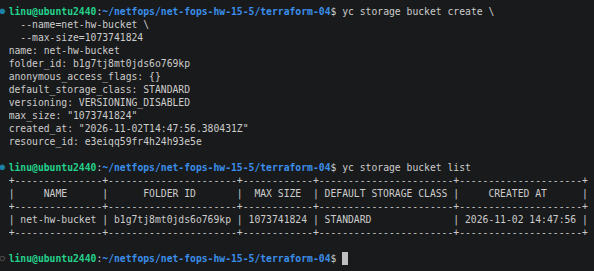

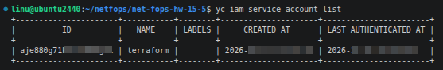

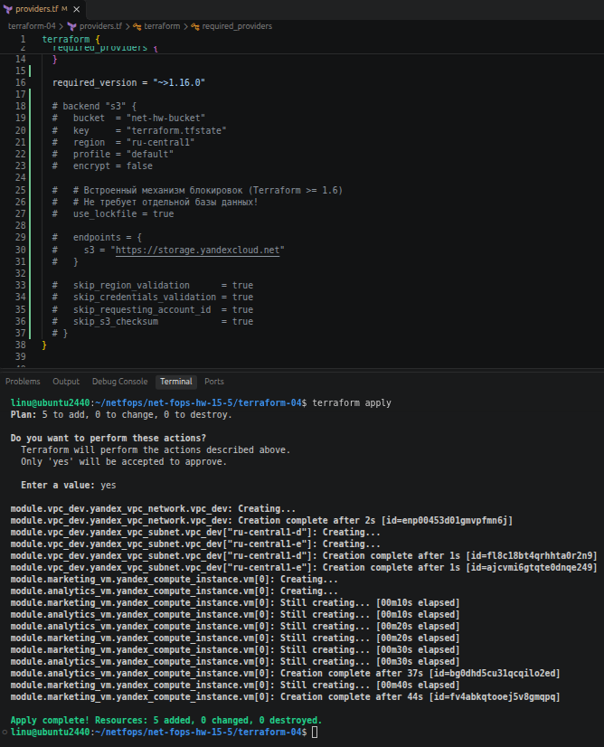

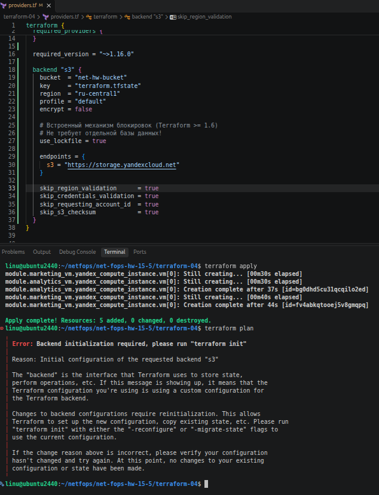

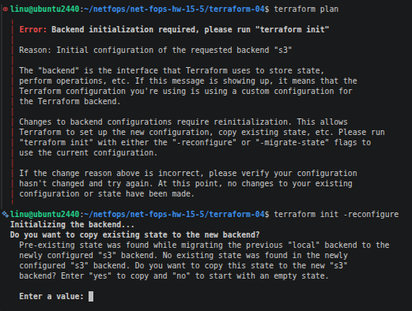


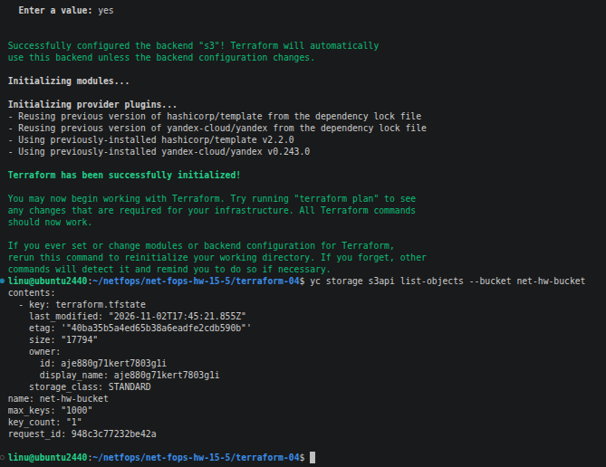


3. Закоммичены в ветку 'terraform-05' все изменения.
4. В первом окне теминала выполнен terraform apply, в другом окне из этой же директории запущен terraform plan.
5. Ответ об ошибке доступа к state.

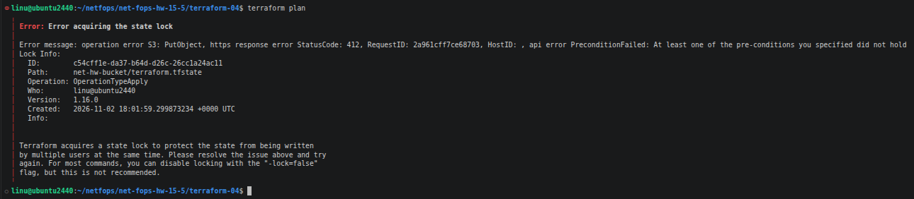

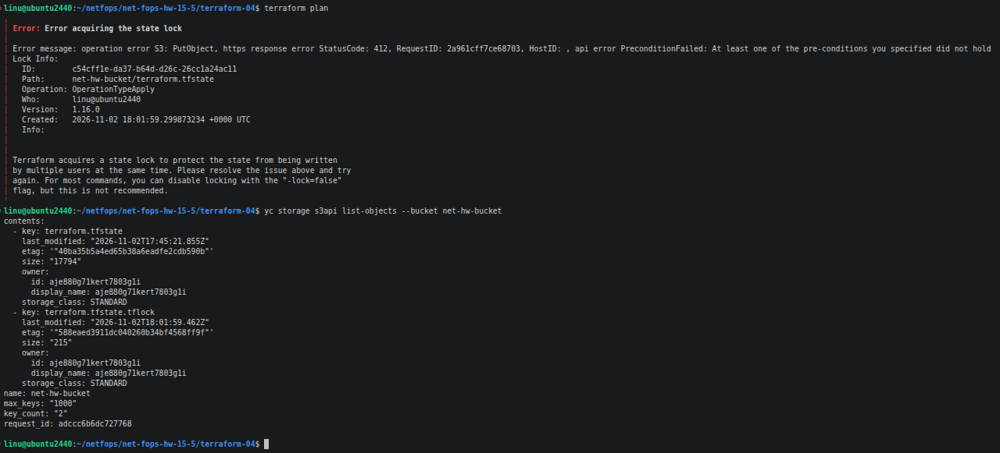

6. Принудительно разблокирован state командой `terraform force-unlock <LOCK_ID>`.
Команду и вывод:

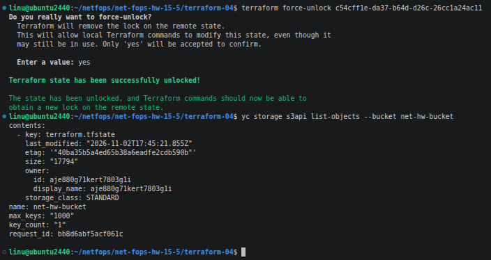

---

### Задание 3  

1. В GitHub из ветки 'terraform-05' сделана новая ветка 'terraform-hotfix'.

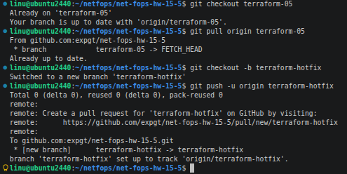

2. Код проверен с помощью tflint и checkov, исправлены все предупреждения и ошибки в 'terraform-hotfix', сделан коммит.

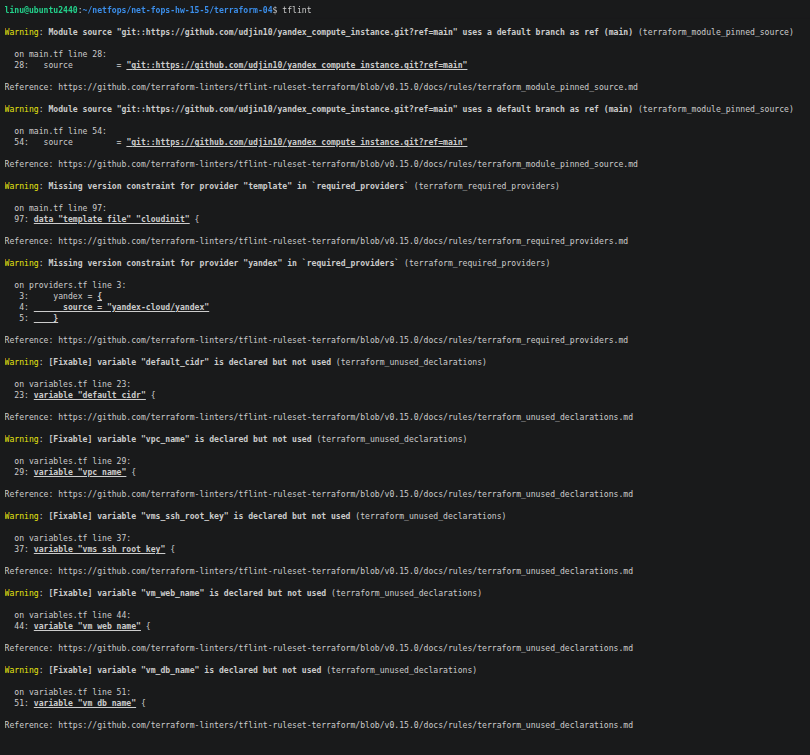

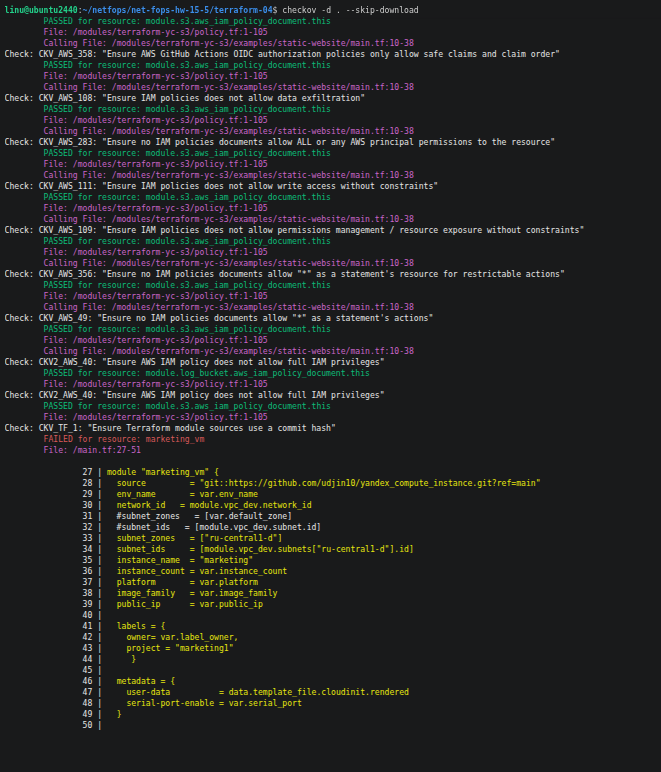

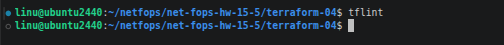

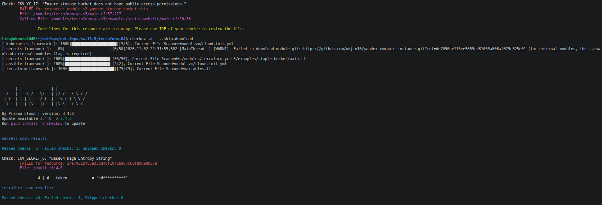

3. Открыт новый pull request 'terraform-hotfix' --> 'terraform-05'.

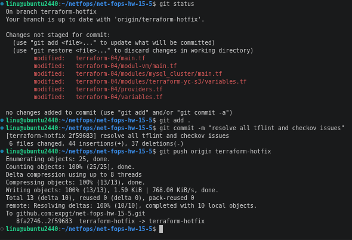

4. В комментарий PR вставлен результат анализа tflint и checkov, план изменений инфраструктуры из вывода команды terraform plan.

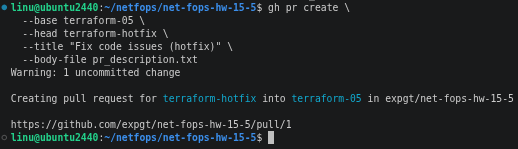

5. Ссылка на PR для ревью.

[Pull_Request](https://github.com/expgt/net-fops-hw-15-5/pull/1)


---

### Задание 4

1. Написаны переменные с валидацией и протестированы, заполнением default верными и неверными значениями.

- type=string, description="ip-адрес" — проверка, что значение переменной содержит верный IP-адрес с помощью функций cidrhost() или regex(). Тесты:  "192.168.0.1" и "1920.1680.0.1";
- type=list(string), description="список ip-адресов" — проверка, что все адреса верны. Тесты:  ["192.168.0.1", "1.1.1.1", "127.0.0.1"] и ["192.168.0.1", "1.1.1.1", "1270.0.0.1"].

Скриншоты проверок из terraform console:

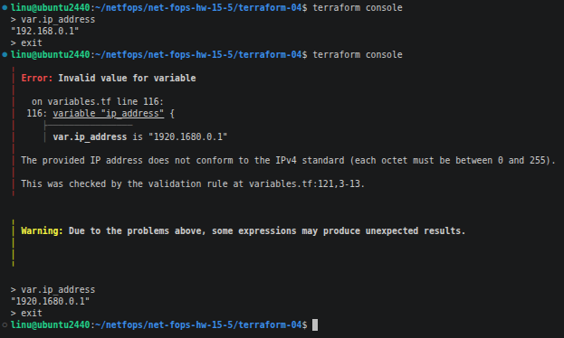

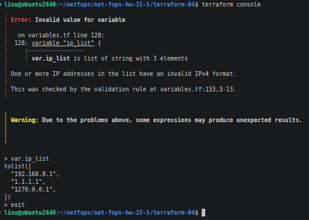

------

## Дополнительные задания (со звёздочкой*)

---

### Задание 5*
1. Написаны переменные с валидацией:
- type=string, description="любая строка" — проверка, что строка не содержит символов верхнего регистра;
- type=object — проверка, что одно из значений равно true, а второе false, т. е. не допускается false false и true true:
```
variable "in_the_end_there_can_be_only_one" {
    description="Who is better Connor or Duncan?"
    type = object({
        Dunkan = optional(bool)
        Connor = optional(bool)
    })

    default = {
        Dunkan = true
        Connor = false
    }

    validation {
        error_message = "There can be only one MacLeod"
        condition = <проверка>
    }
}
```

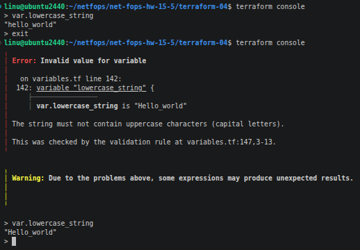

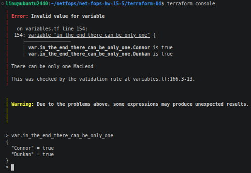

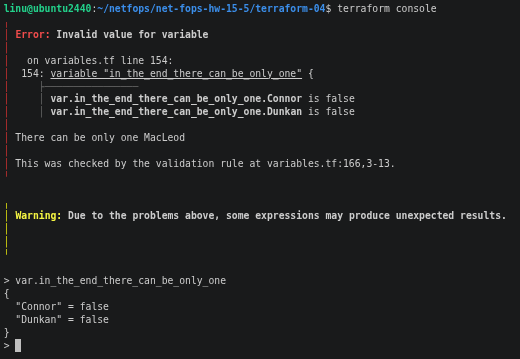


---

### Задание 6*

1. Настроена CI/CD-система GitLab.

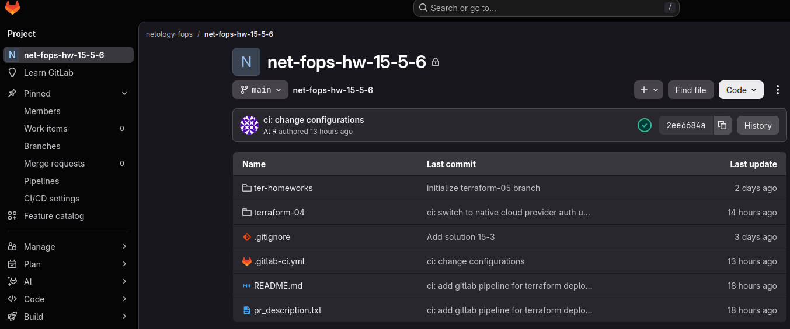

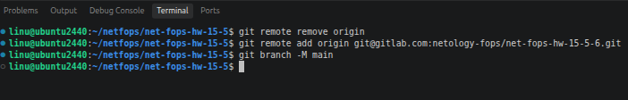

2. С её помощью скачан репозиторий с кодом и инициализирована инфраструктура.

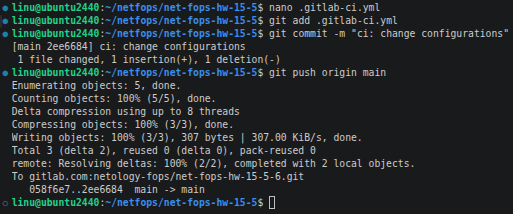

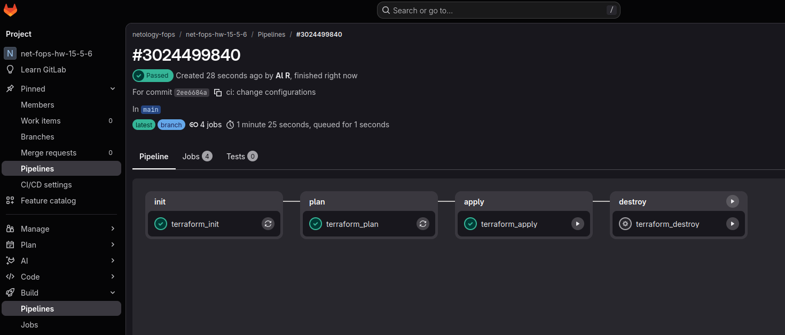

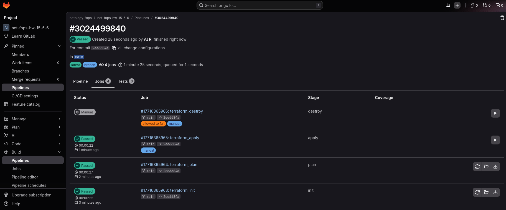

3. Уничтожена инфраструктура через CI/CD-систему.

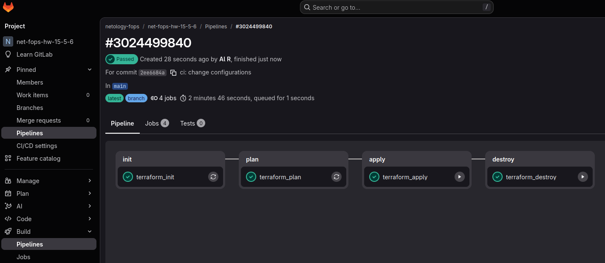

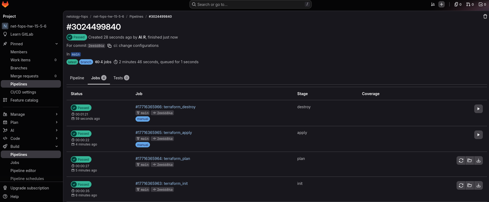


---

### Задание 7*

1. Настроен отдельный terraform root модуль (terraform-04/modules/infrastructure), который создает инфраструктуру для remote state:
   - S3 bucket для tfstate с версионированием
   - Сервисный аккаунт с необходимыми правами (storage.editor)
   - Static access key для сервисного аккаунта
2. Output содержит:
   - Имя bucket
   - Access key ID и Secret key (sensitive)
   - Пример конфигурации backend для использования

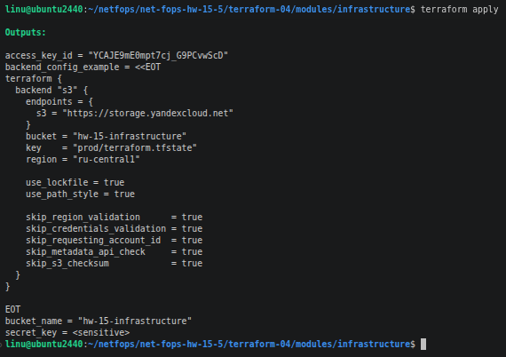

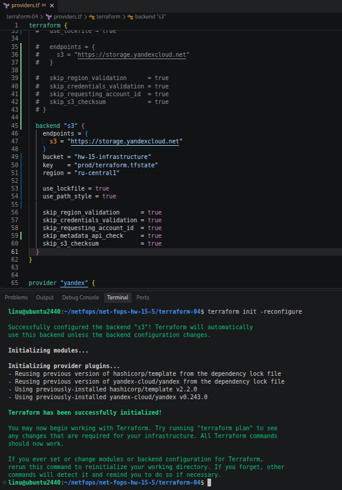


3. После создания инфраструктуры outputs использован для настройки backend в основном проекте (terraform-04).

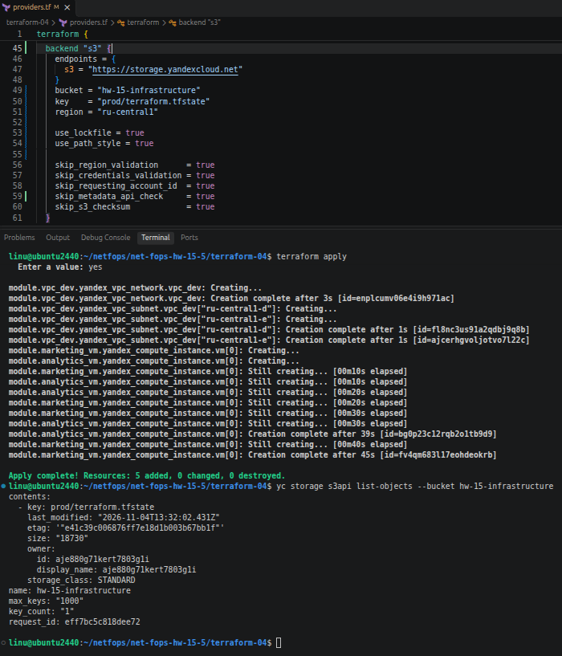